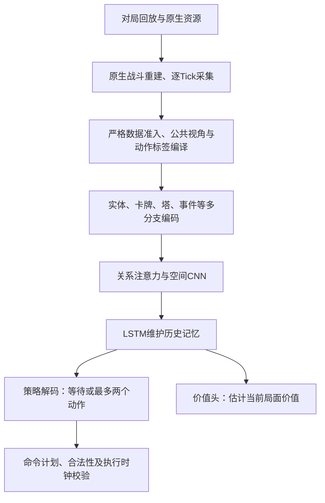

# 当前皇室战争 AI 模型框架简述

更新：2026-09-14。依据本地 `CR-Native-Core` 工作区的代码与最新交接记录，包含尚未提交的实现。

当前研发主线是 **R0 elite-v3：多分支状态编码 + 关系注意力 + 空间卷积 + LSTM记忆 + 自回归动作解码**。默认配置的既有验证记录为 **36,853,407参数，约3685万**。目前已完成局部真实模仿训练闭环，全量数据处理及正式大规模训练仍在准备阶段。

## 1. 整体流程

## 2. 输入与网络

| 部分 | 当前实现 |
| --- | --- |
| 状态输入 | 实体完整72项字段，以及卡牌、塔、分组、战斗事件、全局状态、上一动作和己方未决命令；按公共视角组织，保留未知值标记。 |
| 机制信息 | 卡牌语义与原生定义图，编码单位、投射物、效果和技能等定义及其引用关系。 |
| 关系分支 | 默认6层、384维、12头关系注意力，建模实体之间及实体与候选动作的联系。 |
| 空间分支 | 32×18棋盘，融合显式场面通道、学习散射特征与坐标信息，通过残差CNN编码落点相关空间结构。 |
| 记忆核心 | 768维LSTMCell；每局、每一侧独立维护状态。当前场面摘要也直接进入策略与价值上下文。 |
| 伤害统计 | 独立编码对单位、对塔的累计、最近1秒、最近3秒已确认有效伤害，共6项；不输入未来伤害。 |

原生定义图提供机制相关信息，运行时状态仍需实际采集；完整字段协议不能替代真实数据覆盖验证。

## 3. 如何决策

原生战斗按 **20 Hz** 推进，模型每 **5 Tick，即250毫秒**决策一次。每个窗口可以等待，或输出最多两个动作。

解码顺序为：**是否行动 → 卡牌/技能候选 → 条件落点 → 窗口内时间偏移 → 是否追加第二动作**。第二动作会结合第一动作后的影子合法性状态重新选择，避免重复消耗同一候选。策略同时输出联合动作概率，供模仿训练和PPO使用。

模型输出的是带局号、阵营和Tick的命令计划；完整对战接线还需要原生候选、时钟、命令提交与执行回执共同验证。

## 4. 如何训练

**先模仿学习，再通过自博弈强化学习改进。** 回放先经原生重建、完整观测采集和序列编译，才进入模型训练；当前60万场压缩包属于源数据层。

- **模仿学习（IL/BC）**：用已核验的专家动作监督联合动作概率，未知或未解析标签屏蔽，不伪造为等待。循环状态跨片段延续，梯度按片段截断。
- **强化学习（PPO）**：已有循环PPO、GAE、价值损失与熵正则内核。默认采集段40秒、160个决策步，PPO按48步截断反向传播；这不是IL所有入口统一使用的片段长度。
- **运行管理**：行为策略采用冻结快照，按对局与阵营维护记忆。局部IL已验证模型、优化器和RNN状态的保存恢复；完整异步采集、联赛、评估与长期训练仍需接通和验收。

## 5. 当前进展与版本区别

最新交接记录显示，严格模型已在合格真实短片段上完成反向更新和保存恢复。v17已完成主样本整局语义闭环并修复延迟生成伤害归因。正式数据准入仍需独立验证编译器断言，机制覆盖、旧格式元数据和历史资源匹配还需扩展验证；未启动全量训练。现有小型训练验证权重是随机初始化的管线测试产物，尚不能视为具备实战能力的新专家模型。

旧 `expert_v1 / expert_selfplay_v1` 的177M专家及Stage-2策略、`expert_v2` 中间方案与当前R0属于不同结构和训练路线。旧权重不能直接装入R0；本文不据文件时间判断哪份权重最强。

## 代码与依据

- [模型结构与动作解码](../training_r0/model.py)、[默认尺寸与训练配置](../training_r0/config.py)
- [输入与公共视角](../training_r0/observation.py)、[完整字段编码](../training_r0/elite_encoders.py)、[原生定义图](../training_r0/native_graph.py)
- [模仿训练](../training_r0/il_learning.py)、[PPO内核](../training_r0/learning.py)、[策略会话与记忆](../training_r0/session.py)
- [elite-v3详细说明](TRAINING_R0_ELITE_V3.zh-CN.md)、[v17最新归因修复与准入状态](R0_ATTRIBUTION_V17_STATUS.zh-CN.md)

状态描述以2026-09-14交接和当前代码为准；较早文档中“只有合成验证、尚无真实IL闭环”的部分描述已被局部真实验证进展更新。
